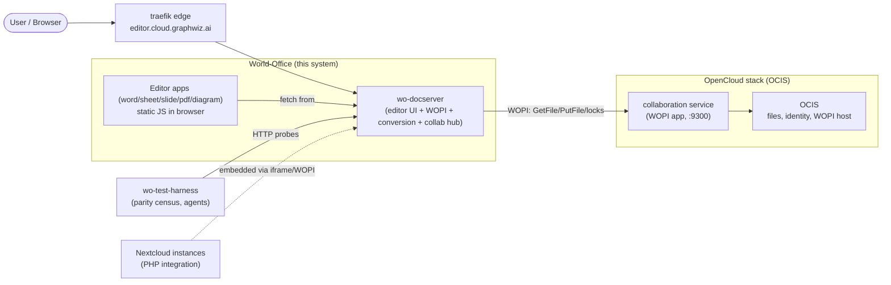

# 3. System Scope and Context

## Context diagram

## Scope

**In scope:**
- Editor frontends (word WYSIWYG is live; sheet/slide/pdf/diagram React apps).
- wo-docserver: serves editor UI, WOPI server endpoints, conversion API
  (`POST /api/conversion/convert`), collaboration hub state
  (`GET /api/documents/<id>/collab/state`), local document store.
- Rust core: 26 crates (16 format parsers with `FormatRoundtrip`, renderer,
  fonts, raster, wo-x2t converter orchestrator, spell, route).
- Services (thin axum/tokio): api-gateway, identity, session, storage,
  conversion, coauthoring, mcp-server, admin-panel.
- Integrations: OpenCloud, Nextcloud, Android, document-server examples.
- Desktop PoC (Tauri), WASM targets.

**Out of scope:** file storage, sharing, user management (OCIS owns these);
reverse TLS termination and DNS (host-level traefik/caddy).

## Interfaces (external)

| Interface | Partner | Protocol |
|-----------|---------|----------|
| WOPI server endpoints | OCIS collaboration service | HTTP + JWT access tokens |
| Editor UI HTTP | Browser | static files over HTTP(S) |
| Conversion API | internal tools, tests, harness | JSON `{source_format, target_format, data: base64}` |
| Discovery/health | orchestrators | `/health` (container), `/healthz` (HTTP) |
| Nextcloud app | Nextcloud servers | PHP app embedding the editor |
