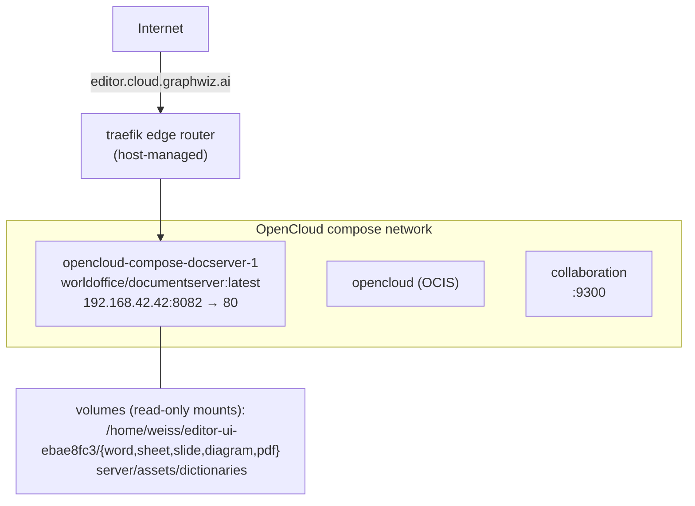

# 7. Deployment View

## Production (host 192.168.42.42, `/home/weiss/opencloud-compose`)

- Image: `worldoffice/documentserver:latest` — multi-stage Docker build from
  `server/` root (`core/crates/wo-docserver/Dockerfile`; release build,
  frontend-dist + dictionaries baked in; cargo layers cached in CI/host).
- Editor UI is **volume-mounted over** the baked-in `editor-ui/word` — editor
  releases are file copies into `~/editor-ui-ebae8fc3/word/`
  (`index.html editor.js i18n.js style.css`), no image rebuild.
- Env: `JWT_SECRET` (shared with OCIS), `WOPI_HOST_URL`, `WOPI_TOKEN_MODE=passthrough`,
  `EDITOR_UI_DIR=/app/editor-ui`, `DOCSERVER_PORT=80`.

## Staging (host 192.168.42.42, `/home/weiss/opencloud-compose-staging`)

Same shape: `ocstaging-docserver-1` on `192.168.42.42:8086 → 80`, plus
`ocstaging-collaboration-1`, `ocstaging-opencloud-1`, `ocstaging-caddy-1`.
**Operational rule:** verify converter behavior against a freshly built local
binary or a freshly rebuilt image — staging images can be weeks stale and must
not be trusted as ground truth for converter gaps.

## CI/CD

- GitHub Actions workflows: ci, deploy, docker, release, security, wasm.
- Docker build matrix covers: identity-, storage-, conversion-,
  coauthoring-, session-service, api-gateway, wo-docserver.
- Rust CI: shared cargo registry cache, `--test-threads=1` for unit tests;
  wo-pdf/wo-webdav excluded from fmt/clippy; cold-worktree `cargo test` is
  the expensive gate (>620 s).
- Deploy sequence (editor): build gates → copy 4 files to deploy dir →
  curl+cmp verify → pageerror sweep → prod container restart if docserver
  binary changed (rebuild image first).
